# Contributing to go-lakekeeper

Thank you for your interest in contributing to **go-lakekeeper**! 🎉  
We welcome issues, bug fixes, new features, and documentation improvements.

Please take a moment to review this guide before submitting a pull request.

## Table of Contents

- [Contributing to go-lakekeeper](#contributing-to-go-lakekeeper)
  - [Table of Contents](#table-of-contents)
  - [Code of Conduct](#code-of-conduct)
  - [Getting Started](#getting-started)
  - [How to Contribute](#how-to-contribute)
    - [Reporting Bugs](#reporting-bugs)
    - [Suggesting Features](#suggesting-features)
    - [Submitting Changes](#submitting-changes)
  - [Coding Guidelines](#coding-guidelines)
  - [Commits and branches](#commits-and-branches)
  - [Development workflow](#development-workflow)
  - [Testing](#testing)
  - [Diagrams](#diagrams)
  - [Knowledge graph (optional)](#knowledge-graph-optional)
  - [Pull Request Process](#pull-request-process)
  - [License](#license)

---

## Code of Conduct

Please read and follow our [Code of Conduct](CODE_OF_CONDUCT.md) to help create a welcoming and respectful community.

## Getting Started

1. Fork the repository and clone it locally.
2. Install [Go 1.26+](https://golang.org/dl/).
3. Run `go mod tidy` to install dependencies.
4. Run `make build` or use your preferred method to build the CLI/client.
5. For a picture of how the SDK and `lkctl` are built, read the [diagrams](docs/diagrams/README.md) in their reading order.

## How to Contribute

### Reporting Bugs

- Use [GitHub Issues](https://github.com/lakekeeper/go-lakekeeper/issues).
- Include a clear title and description.
- Include steps to reproduce, expected behavior, and actual behavior.

### Suggesting Features

- Open an issue
- Provide context and possible use cases.

### Submitting Changes

- Fork the repo and create a new branch: `git checkout -b feat/my-feature`
- Make your changes
- Format your code: `make fmt`
- Run tests: `make test`
- Commit and push your branch
- Open a pull request and follow the PR template

## Coding Guidelines

- Use `gofmt`, `golangci-lint`, and `go vet` before submitting.
- Keep your changes focused: small, atomic PRs are easier to review.
- Follow the [Effective Go](https://golang.org/doc/effective_go.html) guidelines.

## Commits and branches

- Commits and pull request titles follow [Conventional Commits](https://www.conventionalcommits.org), e.g. `fix: handle empty role list` or `feat(storage): support GCS`. Start the description with a lowercase letter, use the imperative mood, and leave off the trailing period; this is convention, not checked by CI. CI checks the PR title's format and accepts the types `build`, `chore`, `ci`, `docs`, `feat`, `fix`, `perf`, `refactor`, `revert`, `style`, and `test`; [release-please](https://github.com/googleapis/release-please) derives versions and `CHANGELOG.md` from it.
- Mark a breaking change with `!` (e.g. `feat!: rename client option`) and describe the migration in the PR.
- Name branches `type/short-description` using the commit type, e.g. `fix/role-list-pagination`.
- `CHANGELOG.md` and `.release-please-manifest.json` are maintained by release-please; leave them untouched.

## Regenerating the API client

The Management API client (`pkg/apis/management/v1/`) is generated from
the upstream OpenAPI spec — **do not hand-edit any file in that
directory.** The full regeneration workflow, including the OpenAPI
postprocessor and the generated/manual file boundary, is documented in
[docs/GENERATION.md](docs/GENERATION.md). The short version:

```sh
make generate
```

## Development workflow

<picture>
  <source media="(prefers-color-scheme: dark)" srcset="docs/diagrams/development-workflow-dark.svg">
  <source media="(prefers-color-scheme: light)" srcset="docs/diagrams/development-workflow-light.svg">
  
</picture>

Explorable version: [`docs/diagrams/development-workflow.html`](docs/diagrams/development-workflow.html)
(GitHub shows its source: download or clone and open it locally). See the
[diagram index](docs/diagrams/README.md) for the other diagrams.

Only the steps marked "Needs a running stack" start one; the commands are under
[Testing](#testing), the commit and PR title rules under
[Commits and branches](#commits-and-branches), and the review steps under
[Pull Request Process](#pull-request-process). The diagram uses these terms:

- **Compose stack**: Lakekeeper with Keycloak, MinIO and OpenFGA, started from
  `docker-compose.yml` by `make test-integration` and `make test-e2e-compose`
  and torn down afterwards (`KEEP_STACK=1` leaves it running).
- **kind cluster**: a local Kubernetes cluster with Lakekeeper installed by
  Helm and no Keycloak. `make test-e2e-kind` creates it and runs only the
  auth-only subset of the `lkctl` end-to-end tests there; the other tests
  skip.
- **`ci-ok`**: the one CI check the `main` branch requires; it passes only when
  lint, drift, unit, integration, both end-to-end jobs and the build pass.

## Testing

Run all tests before opening a PR:

```sh
# go vet + golangci-lint
make validate

# Unit tests
make test

# Integration tests
make test-integration

# lkctl end-to-end tests against the compose stack
make test-e2e-compose
```

`make test-e2e-kind` runs the `lkctl` end-to-end tests against a kind cluster; it needs `kind`, `kubectl` and `helm` installed.

If adding a feature or fixing a bug, include relevant unit and/or integration tests.

## Diagrams

The [diagrams](docs/diagrams/README.md) show how the SDK and `lkctl` are built. Each one is embedded in the doc under `docs/` that covers its topic, next to its JSON source in `docs/diagrams/`.

- **When to update:** your change touches source listed for a diagram in the [drift table](docs/diagrams/README.md#drift-table).
- **How:** follow [Reading and updating the diagrams](docs/diagrams/README.md#reading-and-updating-the-diagrams): edit the diagram's JSON, then run `make diagrams-render DIAGRAMS=<slug>`.
- **What re-rendering needs:** [Archify](https://github.com/tt-a1i/archify), Chrome or Chromium, and Node. Without them you can still read and review diagrams and edit their JSON; ask a maintainer to render it.

## Knowledge graph (optional)

If you use a coding agent, the [graphify](https://github.com/safishamsi/graphify) knowledge graph of the code in `graphify-out/graph.json` gives it a map of the repository. The graph is committed and shared, following graphify's [shared team graph](https://docs.graphify.com/cookbooks/shared-team-graph) recipe; the other files in `graphify-out/` are gitignored and rebuilt locally. `.graphifyignore` lists files the graph skips.

- `make graph` rebuilds the graph (needs [`uv`](https://docs.astral.sh/uv/)). It runs locally, costs no API tokens, and takes a few seconds. Rerun it after code changes and commit the updated `graph.json` with them.
- `make graph-setup` registers graphify's union merge driver in your clone, once. `.gitattributes` routes `graph.json` through it, so two branches that both changed the graph merge without a conflict.

## Pull Request Process

1. Ensure all CI checks pass (unit tests, linters, etc.)
2. Make sure your branch is up to date with `main`
3. Link related issues in the PR description
4. A maintainer will review your PR and may request changes
5. Once approved, your PR will be merged into `main`

## License

By contributing, you agree that your contributions will be licensed under the [Apache 2.0 License](LICENSE).

---

Thanks again for your support and contributions!
Let's build something great together.