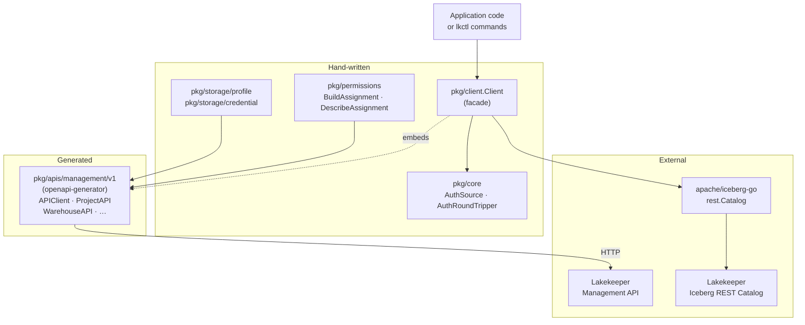
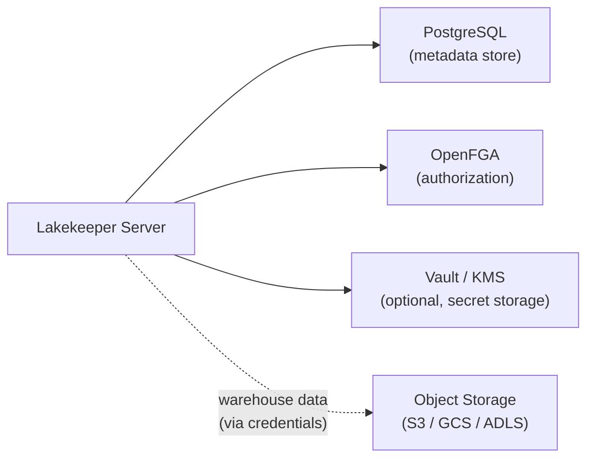
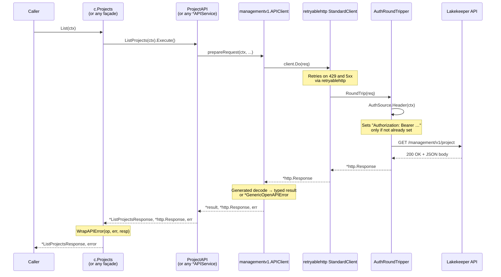

# Architecture

`go-lakekeeper` is a Go SDK and CLI (`lkctl`) for the
[Lakekeeper](https://docs.lakekeeper.io) Management and Iceberg REST
Catalog APIs. The Management API client is generated from the upstream
OpenAPI spec; everything else — the auth layer, the retry layer, the CLI,
and the ergonomic builders for storage and permissions — is hand-written.

For the generated/manual split, regeneration workflow, and the OpenAPI
postprocessor, see [GENERATION.md](GENERATION.md). For a per-package tour
of types and entry points, see [PACKAGES.md](PACKAGES.md).

## Component Overview



`pkg/client.Client` adds:

- **Resource façades** (`c.Warehouses`, `c.Projects`, `c.Roles`,
  `c.Users`, `c.Server`, `c.Permissions`): one method call per
  operation, returning `(value, error)`. They own request construction,
  query options and paging, **Project scoping** (see below), and the one
  error model. They cover every operation `lkctl` uses, and `lkctl`
  commands call nothing else; see
  [PACKAGES.md](PACKAGES.md#resource-façades-one-call-ergonomic-surface).
- **Auth wiring** through `core.AuthRoundTripper`, which injects the
  `Authorization` header on every outbound request.
- **Retries** by wrapping the auth-injecting transport in
  `retryablehttp.NewClient().StandardClient()`.
- **Optional bootstrap** at construction time via `WithInitialBootstrap`.
- **`CatalogV1(ctx, projectID, warehouse, …)`** — a one-shot helper that
  delegates to `apache/iceberg-go`.

`Client` also **embeds** `*managementv1.APIClient`, the escape hatch: every
generated service stays reachable as a public field (`c.ProjectAPI`,
`c.WarehouseAPI`, `c.RoleAPI`, `c.UserAPI`, `c.ServerAPI`,
`c.PermissionsOpenfgaAPI`, `c.AuthorizationAPI`, `c.GrantAPI`, `c.TagAPI`,
`c.TasksAPI`). Use it for operations without a façade (tags, tasks,
grants, authorization checks, …) or when you need the raw
`*http.Response`.

## Server-side context

`go-lakekeeper` is a **client** — it does not run any server-side
components. The Lakekeeper server itself depends on:



The integration-test stack (`make test-integration`) brings up
Lakekeeper + **Keycloak** (OIDC IdP) + **MinIO** (S3-compatible storage) +
**OpenFGA** via `docker-compose`, which is the canonical reference
environment for this SDK.

## Request Lifecycle

Every SDK call follows the same path from the resource façade through the
generated service and the embedded `APIClient` and out to the wire. Callers
of the escape hatch enter at the generated service and get the raw triple
back.



Key points:

- **The generated client is the only place the URL is assembled.** The
  base URL is set on the `Configuration` once at client construction
  ([`pkg/client/client.go`](../pkg/client/client.go)) and never changes
  per-request.
- **Auth is per-request.** `AuthSource.Init` runs once during
  `NewWithAuthSource`; `AuthSource.Header` is then called by
  `AuthRoundTripper` on every request. `OAuthTokenSource` defers cache
  and renewal logic to `golang.org/x/oauth2`, so token refresh is
  transparent.
- **Retries are decoupled from the generated client.** `retryablehttp`
  retries `429` and any `>= 500` status with linear-jitter backoff
  (defaults: 100 ms–400 ms, max 5 retries). Disable with `WithoutRetries()`
  or tune with `WithRetryMax`, `WithRetryWait`, `WithCheckRetry`,
  `WithBackoff`, and `WithErrorHandler`.
- **One error model.** The generated client turns non-2xx responses into
  `*managementv1.GenericOpenAPIError`. Façades pass it and the
  `*http.Response` to `client.WrapAPIError`, which returns a
  `*client.APIError` carrying the status code, the raw body, and the
  decoded error model, and unwrapping to the generated error. Transport
  and context errors stay wrapped with `%w`. See
  [PACKAGES.md](PACKAGES.md#errors).

## Bootstrap Flow

When `WithInitialBootstrap(true, isOperator, userType)` is passed to
`NewWithAuthSource`, the client calls the server façade's `Server.Info`
during construction; if the server reports `bootstrapped: false`, it then
calls `Server.Bootstrap` automatically. An already bootstrapped server is
left alone. This happens at most once per client instance (see
[`pkg/client/client.go`](../pkg/client/client.go) → `runBootstrap`), and a
failure fails construction with the façade's `*client.APIError`.

If the first argument is `false` (the user did not accept the terms of
use), the option is a no-op — the constructor never calls `Info` or
`Bootstrap`.

## Project Scoping

Resources that belong to a project (warehouses, roles) take the project
per call, and so do `Projects.Get`, `Rename`, `Delete`, and
`Permissions.Projects`, which act on the project they name (the server's
default project when they name none). A project-scoped façade method
accepts a trailing, optional `...client.CallOption`;
`client.WithProject(id)` names the project.
A method takes the option only when its endpoint accepts `x-project-id`:
for warehouses that is Create and List, while the calls that address a
warehouse by id (`Get`, `Rename`, `Statistics`, …) take none:

```go
c.Warehouses.List(ctx, nil, client.WithProject(projectID)) // x-project-id: <projectID>
c.Warehouses.List(ctx, nil)                                // no project sent
```

- With `WithProject`, the façade sends the `x-project-id` header.
- Without it, the façade sends no project. The server then applies its
  **default project**: the nil UUID unless the operator set
  `LAKEKEEPER__DEFAULT_PROJECT_ID`. If the operator disabled the default
  project, the server answers 400 `ProjectIdMissing`.
- `WithProject("")` is not "no project": the call fails with
  `client.ErrEmptyProjectID` before sending anything, so an unset variable
  can't silently target (or, with `Projects.Delete`, delete) the default
  project.
- The façades never send the deprecated `projectId` query parameter or
  `project-id` body field. When both are sent, Lakekeeper lets the
  deprecated one win over the header. A request model that still carries
  the body field (`CreateWarehouseRequest`, `CreateRoleRequest`,
  `SearchRoleRequest`) has it moved to the header: alone it acts like
  `WithProject`, equal to `WithProject` it is dropped, and a different
  project fails with `client.ErrProjectIDConflict`. The caller's request
  is not modified.

The one place that decides how a project is sent is the unexported
`withProject` helper in `pkg/client/call_options.go`. `lkctl`'s
`-p/--project` flag and the optional `[PROJECT-ID]` argument of the
`project` permission commands have no default: omitted, they send no
option; given, they map to `WithProject`, so an explicit empty value is
rejected. There is no client-wide default project: each call names
its project or leaves the choice to the server.

Callers of the generated services (the escape hatch) set the header
themselves (`c.RoleAPI.ListRoles(ctx).XProjectId(projectID).Execute()`)
and should leave the deprecated `ProjectId(...)` query builder and
`project-id` body field unset, for the reason above. Project-independent
operations (server, users, project create and list) do not need the
header.
