# Architecture

`go-lakekeeper` is a Go SDK and CLI (`lkctl`) for the
[Lakekeeper](https://docs.lakekeeper.io) Management and Iceberg REST
Catalog APIs. The Management API client is generated from the upstream
OpenAPI spec; everything else — the auth layer, the retry layer, the CLI,
and the ergonomic builders for storage and permissions — is hand-written.

For the generated/manual split, regeneration workflow, and the OpenAPI
postprocessor, see [GENERATION.md](GENERATION.md). For a per-package tour
of types and entry points, see [PACKAGES.md](PACKAGES.md).

## System Context

<picture>
  <source media="(prefers-color-scheme: dark)" srcset="diagrams/system-context-dark.svg">
  <source media="(prefers-color-scheme: light)" srcset="diagrams/system-context-light.svg">
  
</picture>

Explorable version: [`diagrams/system-context.html`](diagrams/system-context.html)
(GitHub shows its source: download or clone and open it locally). See the
[diagram index](diagrams/README.md) for the other diagrams.

The diagram uses these terms:

- **Application code**: your Go program. It usually imports the umbrella
  package only.
- **`lkctl`**: the CLI in `cmd/`. It builds a client from its flags and
  calls the resource façades only.
- **Umbrella package**: `pkg/lakekeeper`. It re-exports the client, its
  constructors, the storage and permission builders, and the common request
  and response types, so most call sites need one import path.
- **Client**: `pkg/client.Client`, with the auth and transport primitives
  from `pkg/core`. It holds the resource façades, the auth wiring, the
  retries and the `CatalogV1` helper.
- **Resource façade**: one of the client's fields `Warehouses`, `Projects`,
  `Roles`, `Users`, `Server` and `Permissions`: one method call per
  operation, returning `(value, error)`.
- **Generated SDK**: `pkg/apis/management/v1`, generated from the
  Management API's OpenAPI spec (see [GENERATION.md](GENERATION.md)).
  The client embeds its `APIClient`.
- **Escape hatch**: the embedded `APIClient`, whose generated services stay
  reachable for operations without a façade.
- **Auth source**: a `core.AuthSource` that supplies the `Authorization`
  header: OAuth2 client credentials, a static access token, or a Kubernetes
  service account token.
- **Identity provider**: the OAuth2 / OpenID Connect server that issues
  access tokens, for example Keycloak. Only the client credentials auth
  source fetches tokens from it; the Lakekeeper server validates every
  token against it.
- **`iceberg-go`**: `apache/iceberg-go`, the Apache Iceberg library for
  Go. The client's `CatalogV1` helper returns its REST catalog
  (`rest.Catalog`) for one project and warehouse.
- **Lakekeeper server**: one Lakekeeper installation, which serves the
  Management API and the Iceberg REST Catalog. In the domain model it is
  the [server](AUTHORIZATION.md#the-lakekeeper-authorization-model)
  resource.
- **Management API**: Lakekeeper's REST API under `/management/v1` for
  servers, projects, warehouses, users, roles and permissions.
- **Iceberg REST Catalog**: Lakekeeper's Apache Iceberg REST catalog under
  `/catalog`, reached through `iceberg-go`.
- **Metadata store**, **authorization backend**, **secret storage** and
  **object storage**: the Lakekeeper server's own dependencies (PostgreSQL,
  OpenFGA, an optional secret backend, and S3, GCS or ADLS). The SDK runs
  none of them.

`pkg/client.Client` adds:

- The resource façades (see above). They own request construction,
  query options and paging, project scoping (see below), and the one
  error model. They cover every operation `lkctl` uses, and `lkctl`
  commands call nothing else; see
  [PACKAGES.md](PACKAGES.md#resource-façades-one-call-ergonomic-surface).
- **Auth wiring** through `core.AuthRoundTripper`, which injects the
  `Authorization` header on every outbound request. It wraps a pooled
  transport, or the transport of the client given to `WithHTTPClient`
  (custom TLS, proxy, timeouts).
- **Retries** by wrapping the auth-injecting transport in
  `retryablehttp.NewClient().StandardClient()`.
- **Optional bootstrap** at construction time via `WithInitialBootstrap`.
- **`CatalogV1(ctx, projectID, warehouse, …)`** — a one-shot helper that
  delegates to `apache/iceberg-go`, sharing the `WithHTTPClient` transport
  when one was supplied.

`Client` also **embeds** `*managementv1.APIClient`, the escape hatch: every
generated service stays reachable as a public field (`c.ProjectAPI`,
`c.WarehouseAPI`, `c.RoleAPI`, `c.UserAPI`, `c.ServerAPI`,
`c.PermissionsOpenfgaAPI`, `c.AuthorizationAPI`, `c.GrantAPI`, `c.TagAPI`,
`c.TasksAPI`). Use it for operations without a façade (tags, tasks,
grants, authorization checks, …) or when you need the raw
`*http.Response`.

`go-lakekeeper` is a **client**: it does not run any server-side
components. The [compose stack](../CONTRIBUTING.md#development-workflow)
that `make test-integration` starts is the canonical reference environment
for this SDK.

## Request Lifecycle

Every SDK call follows the same path from the resource façade through the
generated service and the embedded `APIClient` and out to the wire. The
diagram follows `c.Projects.List(ctx)`; every façade method takes the same
path. Callers of the escape hatch enter at the generated service and get
the raw triple back.

<picture>
  <source media="(prefers-color-scheme: dark)" srcset="diagrams/request-lifecycle-dark.svg">
  <source media="(prefers-color-scheme: light)" srcset="diagrams/request-lifecycle-light.svg">
  
</picture>

Explorable version: [`diagrams/request-lifecycle.html`](diagrams/request-lifecycle.html)
(GitHub shows its source: download or clone and open it locally). See the
[diagram index](diagrams/README.md) for the other diagrams.

The diagram uses the terms resource façade, escape hatch, auth source and
Management API as defined under [System Context](#system-context), and
these:

- **Caller**: application code or `lkctl`, calling a façade method.
- **Generated service**: one of the `*APIService` types of the generated
  SDK, reachable on the client as `c.ProjectAPI`, `c.WarehouseAPI`, ….
  Each operation is a request builder ending in `Execute()`, which returns
  the typed result, the `*http.Response` and an error.
- **API client**: the generated `managementv1.APIClient`. It builds the
  request from the base URL (`prepareRequest`) and sends it through its
  HTTP client (`callAPI`).
- **Retrying client**: the retrying HTTP client, the `http.Client` the
  client hands the API client, from `retryablehttp`. It repeats a failed
  attempt.
- **`AuthRoundTripper`**: `core.AuthRoundTripper`, the transport below the
  retrying client that sets the `Authorization` header from the auth
  source.
- **Typed result**: the decoded response model, such as
  `*managementv1.ListProjectsResponse`.
- **`GenericOpenAPIError`**: the generated client's error for a status of
  300 or more, or a body it cannot decode.
- **`APIError`**: `*client.APIError`, the one error type the façades
  return for a failed response.

Key points:

- **The generated client is the only place the URL is assembled.** The
  base URL is set on the `Configuration` once at client construction
  ([`pkg/client/client.go`](../pkg/client/client.go)) and never changes
  per-request.
- **Auth is per-request.** `AuthSource.Init` runs once during
  `NewWithAuthSource`; `AuthSource.Header` is then called by
  `AuthRoundTripper` on every attempt, including retries. A header the
  caller already set is kept. `OAuthClientCredentialsAuthSource` defers
  cache and renewal logic to `golang.org/x/oauth2`, so token refresh is
  transparent.
- **Retries are decoupled from the generated client.** `retryablehttp`
  retries transport errors, `429`, and any `>= 500` status except `501`,
  with exponential backoff (library defaults: 1 s–30 s, at most 4
  retries). Disable with `WithoutRetries()` or tune with `WithRetryMax`,
  `WithRetryWait`, `WithCheckRetry`, `WithBackoff`, and
  `WithErrorHandler`.
- **One error model.** The generated client turns a status of 300 or more
  into a `GenericOpenAPIError`. Façades pass it and the `*http.Response` to
  `client.WrapAPIError`, which returns an `APIError` carrying the status
  code, the raw body, and the decoded error model, and unwrapping to the
  generated error. Transport and context errors stay wrapped with `%w`, and
  so does the error `retryablehttp` returns by default once its retries
  are used up, because it then returns no response. See
  [PACKAGES.md](PACKAGES.md#errors).

## Bootstrap Flow

When `WithInitialBootstrap(true, isOperator, userType)` is passed to
`NewWithAuthSource`, the client calls the server façade's `Server.Info`
during construction; if the server reports `bootstrapped: false`, it then
calls `Server.Bootstrap` automatically. An already bootstrapped server is
left alone. This happens at most once per client instance (see
[`pkg/client/client.go`](../pkg/client/client.go) → `runBootstrap`), and a
failure fails construction with the façade's `*client.APIError`.

If the first argument is `false` (the user did not accept the terms of
use), the option is a no-op — the constructor never calls `Info` or
`Bootstrap`.

## Project Scoping

Resources that belong to a project (warehouses, roles) take the project
per call, and so do `Projects.Get`, `Rename`, `Delete`, and
`Permissions.Projects`, which act on the project they name (the server's
default project when they name none, except for the destructive calls
below). A project-scoped façade method accepts a trailing
`...client.CallOption`;
`client.WithProject(id)` names the project.
A method takes the option only when its endpoint accepts `x-project-id`:
for warehouses that is Create and List, while the calls that address a
warehouse by id (`Get`, `Rename`, `Statistics`, …) take none:

```go
c.Warehouses.List(ctx, nil, client.WithProject(projectID)) // x-project-id: <projectID>
c.Warehouses.List(ctx, nil)                                // no project sent
```

<picture>
  <source media="(prefers-color-scheme: dark)" srcset="diagrams/project-scoping-dark.svg">
  <source media="(prefers-color-scheme: light)" srcset="diagrams/project-scoping-light.svg">
  
</picture>

Explorable version: [`diagrams/project-scoping.html`](diagrams/project-scoping.html)
(GitHub shows its source: download or clone and open it locally). See the
[diagram index](diagrams/README.md) for the other diagrams.

The diagram uses the terms resource façade and Lakekeeper server as
defined under [System Context](#system-context), `APIError` as defined under
[Request Lifecycle](#request-lifecycle), project and default project as
defined in [AUTHORIZATION.md](AUTHORIZATION.md#the-lakekeeper-authorization-model),
and these:

- **Project scoping**: how a façade call names the project it runs in.
- **Project-scoped call**: a call to a façade method that takes a
  trailing `...client.CallOption`, because its endpoint accepts the
  `x-project-id` header.
- **`WithProject`**: `client.WithProject(id)`, the call option that names
  the project. The project it names is the **named project**.
- **`x-project-id` header**: the HTTP header that carries the project.
  It is the only way the façades send one.
- **Deprecated body field**: the `project-id` field that
  `CreateWarehouseRequest`, `CreateRoleRequest` and `SearchRoleRequest`
  still carry.
- **`ErrProjectIDConflict`, `ErrProjectRequired`, `ErrEmptyProjectID`**:
  the client's errors for a call it rejects before sending anything;
  match them with `errors.Is`.
- **`ProjectIdMissing`**: the server's 400 error when a call names no
  project and the operator disabled the default project. The façade
  returns it as an `APIError`.

What each case sends:

- With `WithProject`, the façade sends the `x-project-id` header.
- Without it, the façade sends no project. The server then applies its
  default project: the nil UUID unless the operator set
  `LAKEKEEPER__DEFAULT_PROJECT_ID`. If the operator disabled the default
  project, the server answers 400 `ProjectIdMissing`.
- `WithProject("")` is not "no project": the call fails with
  `client.ErrEmptyProjectID` before sending anything, so an unset variable
  can't silently target the default project.
- The destructive project-level calls are the exception to "omitting is
  valid": `Projects.Delete` and `Permissions.Projects.Grant` / `Revoke`
  fail with `client.ErrProjectRequired` without `WithProject` and send
  nothing, so a project is never deleted, and its permissions never
  changed, by omission. To act on the default project, name it. This
  deliberately deviates from the façade spec (VAK-853).
- The façades never send the deprecated `projectId` query parameter or
  `project-id` body field. When both are sent, Lakekeeper lets the
  deprecated one win over the header. A request model that still carries
  the body field (`CreateWarehouseRequest`, `CreateRoleRequest`,
  `SearchRoleRequest`) has it moved to the header: alone it acts like
  `WithProject`, equal to `WithProject` it is dropped, and a different
  project fails with `client.ErrProjectIDConflict`. The caller's request
  is not modified.

How a project is sent is decided in one file,
`pkg/client/call_options.go`: `withProject` (header or nothing, empty
rejected), `withRequiredProject` (the destructive calls: no fallback),
and `withBodyProject` (the deprecated body field). Every project-scoped
façade method goes through them. `lkctl`'s `-p/--project` flag and the
optional `[PROJECT-ID]` argument of `project access` and `project
assignments` have no default: omitted, they send no option; given, they
map to `WithProject`, so an explicit empty value is rejected. `project
delete`, `grant`, and `revoke` take a required `PROJECT-ID`. There is no
client-wide default project: each call names its project or leaves the
choice to the server.

Callers of the generated services (the escape hatch) set the header
themselves (`c.RoleAPI.ListRoles(ctx).XProjectId(projectID).Execute()`)
and should leave the deprecated `ProjectId(...)` query builder and
`project-id` body field unset, for the reason above. Project-independent
operations (server, users, project create and list) do not need the
header.
