# Generated API client

The Management API client (`pkg/apis/management/v1/`) is generated from the
upstream Lakekeeper OpenAPI spec. Everything else in the repo — including the
`pkg/client` facade, the `lkctl` CLI, and the storage / permissions builder
packages — is hand-written.

This document is the single source of truth for **what is generated**, **how
to regenerate it**, and **why a postprocessor is involved**.

## What is generated

Everything under [`pkg/apis/management/v1/`](../pkg/apis/management/v1/) is
regenerated wholesale on every `make generate` run. The Makefile `rm -rf`s
the directory before invoking the generator (see
[Makefile:138](../Makefile#L138)), so any hand-edits there are silently
discarded the next time someone regenerates.

Files carrying this header are generator output and **must not be
hand-edited**:

```go
// Code generated by OpenAPI Generator (https://openapi-generator.tech);
// DO NOT EDIT.
```

The package's own [`.openapi-generator-ignore`](../pkg/apis/management/v1/.openapi-generator-ignore)
only suppresses files we don't want emitted into the repo at all
(`README.md`, `git_push.sh`, `.travis.yml`, `api/openapi.yaml`). It does
**not** preserve hand-edited files — there are none.

The accompanying [`.openapi-generator/FILES`](../pkg/apis/management/v1/.openapi-generator/FILES)
manifest enumerates every file the generator owns, so a regeneration that
adds or removes files produces an obvious diff.

## What is NOT generated

| Package | Purpose |
|---|---|
| [`pkg/client/`](../pkg/client/) | Facade over the generated `managementv1.APIClient`: auth wiring, retry layering, optional bootstrap, `CatalogV1` helper, `APIError` |
| [`pkg/core/`](../pkg/core/) | `AuthSource` interface + three implementations, `AuthRoundTripper`, `RequestOption` helpers |
| [`pkg/permissions/`](../pkg/permissions/) | Generic `BuildAssignment[T]` / `DescribeAssignment` helpers for the generated `*Assignment` union types |
| [`pkg/storage/profile/`](../pkg/storage/profile/) | Ergonomic builders for `StorageProfile{S3,Gcs,Adls}` and `TabularDeleteProfile` |
| [`pkg/storage/credential/`](../pkg/storage/credential/) | Ergonomic builders for `StorageCredential` variants |
| [`pkg/apis/management/v1tests/`](../pkg/apis/management/v1tests/) | Wire-format round-trip tests for the generated assignment models. Kept outside `v1/` so test fixtures don't bleed into the generated package |
| [`cmd/lkctl/`](../cmd/lkctl/), [`integration/`](../integration/), [`pkg/common`](../pkg/common/), [`pkg/version`](../pkg/version/), [`pkg/testutil`](../pkg/testutil/) | All hand-written |

## How to regenerate

```sh
make generate
```

<picture>
  <source media="(prefers-color-scheme: dark)" srcset="diagrams/generation-pipeline-dark.svg">
  <source media="(prefers-color-scheme: light)" srcset="diagrams/generation-pipeline-light.svg">
  
</picture>

Explorable version: [`diagrams/generation-pipeline.html`](diagrams/generation-pipeline.html)
(GitHub shows its source: download or clone and open it locally). See the
[diagram index](diagrams/README.md) for the other diagrams.

Generated code changes only through the three inputs you edit: the OpenAPI
spec, the postprocessor and the generator config (plus the ignore file, for
which files are emitted at all). The diagram uses the term generated SDK as
defined under [ARCHITECTURE.md System Context](ARCHITECTURE.md#system-context),
and these:

- **`make generate`**: the make target that runs every step below, in order.
- **OpenAPI spec**: the committed
  [`api/openapi/management-open-api.yaml`](../api/openapi/management-open-api.yaml),
  copied by hand from the **Lakekeeper repository** (the upstream
  [lakekeeper/lakekeeper](https://github.com/lakekeeper/lakekeeper)); see
  [Updating the spec](#updating-the-spec).
- **openapi-generator**: the `openapitools/openapi-generator-cli` container
  image with the `go` generator, pinned by `OPENAPI_GENERATOR_VERSION` in the
  Makefile.
- **Generator config**: see [Generator configuration](#generator-configuration).
- **Ignore file**: [`api/openapi/.openapi-generator-ignore`](../api/openapi/.openapi-generator-ignore),
  the generator output files to leave out of the package.
- **Postprocessor**: see [The postprocessor](#the-postprocessor).
- **Format and tidy**: `goimports`, `go mod tidy` and `make fmt` over the
  postprocessed tree.
- **Hand edit**: any edit under `pkg/apis/management/v1/`. The next
  `make generate` deletes it (see [What is generated](#what-is-generated)).

The pipeline (see [Makefile:135-155](../Makefile#L135-L155)):

1. `rm -rf pkg/apis/management/v1` and recreate the directory.
2. Copy the top-level [`.openapi-generator-ignore`](../api/openapi/.openapi-generator-ignore)
   into the output directory.
3. Run `openapitools/openapi-generator-cli:v7.27.0 generate` in a container.
   Input spec (`-i`): the committed
   [`api/openapi/management-open-api.yaml`](../api/openapi/management-open-api.yaml),
   unmodified. Generator config (`-c`):
   [`api/openapi/management-config.yaml`](../api/openapi/management-config.yaml).
4. `go run ./api/openapi/postprocess`. See [The postprocessor](#the-postprocessor) below.
5. `goimports -w` + `go mod tidy` + `make fmt`.

The container engine resolves to `docker` or `podman` depending on what's on
PATH (see [Makefile:45](../Makefile#L45)), so `make generate` works on either.

The generator config is intentionally minimal —
[`management-config.yaml`](../api/openapi/management-config.yaml) lists only
the options that deviate from upstream defaults, with an inline comment
explaining each.

## Updating the spec

The committed [`management-open-api.yaml`](../api/openapi/management-open-api.yaml)
is the source of truth. Update it by copying
[`docs/docs/api/management-open-api.yaml`](https://github.com/lakekeeper/lakekeeper/tree/main/docs/docs/api)
from the Lakekeeper repository at the release tag (or commit) the client
targets, then run `make generate` and commit the spec and the regenerated tree in the
**same commit** so the diff stays reviewable. Name the Lakekeeper tag or
commit in the commit message.

The spec goes into the generator unmodified: unions, enum names, nullable
fields and query-parameter encoding all come straight from the spec and the
generator config. Array query parameters such as `relations` use the OpenAPI
default (`form`, exploded), so the client sends `?relations=a&relations=b`,
which is the form Lakekeeper (v0.15.0 and later) parses. It silently ignores
bracket notation (`relations[0]=a`), so a filter sent that way returns
unfiltered results instead of failing.

## The postprocessor

Located at [`api/openapi/postprocess/`](../api/openapi/postprocess/); runs in
`make generate` after the generator and before goimports/gofmt. It applies two
forward-compat relaxations to the generated tree so a client built against an
older spec keeps working against a newer Lakekeeper (additive server changes
must not break decoding):

- **Strip `decoder.DisallowUnknownFields()`** from model `UnmarshalJSON`s, so
  responses carrying a field the SDK's spec predates (as
  `allowed-format-versions` on the warehouse object once was) decode instead of
  erroring.
  The required-property presence check (a separate phase) and the oneOf
  discriminator dispatch are untouched; `newStrictDecoder` in `utils.go` (used
  only for the discriminator-lookup map) is preserved.
- **Relax enum validation** — rewrite each enum `UnmarshalJSON`'s
  `return fmt.Errorf("%+v is not a valid X", value)` to store the value and
  return nil. A newer server's enum value (as the `set_format_version_policy`
  `WarehouseAction` once was) is preserved as the raw string rather than failing the whole
  response; callers compare against the generated `AllowedXEnumValues`.

Relaxing strict decoding is safe for unions: they decode by discriminator, or
— for the few without one in the spec (e.g. `NamespaceIdentOrUuid`) — by
required-field presence, neither of which relies on `DisallowUnknownFields`.
The integration `*_GetAccess` tests treat unknown (newer-than-spec) actions as
logged, not failures (see `assertAllowedActionsSubset`).

## Generator configuration

[`management-config.yaml`](../api/openapi/management-config.yaml) keeps a
small set of knobs flipped from openapi-generator's defaults. The current
choices, with the intent behind each:

| Key | Value | Why |
|---|---|---|
| `useOneOfDiscriminatorLookup` | `true` | Lets the generator emit unambiguous unmarshal logic for unions that carry a `discriminator` block in the spec |
| `enumClassPrefix` | `true` | Prefixes enum constants with their type (`S3FLAVOR_AWS`); without it, values shared across enums (`create`, `delete`, `select` on several `*Action` enums) collide as package-level constants |
| `generateUnmarshalJSON` | `true` | Kept on for the required-field presence check, which also lets unions without a spec discriminator pick their matching variant. Its `DisallowUnknownFields` side effect (and the strict enum-value validation) is the wrong posture for a client library, so the **postprocessor** strips it after generation — see below. Net result: required checks + discriminator decode retained, additive server fields/enum values tolerated |
| `generateInterfaces` | `false` | We expose the generated client through `pkg/client`, so the additional `XxxAPI` interface variants are not needed |
| `withGoMod`, `isGoSubmodule` | `false`, `true` | Embed the generated package inside this module instead of producing a standalone Go SDK |
