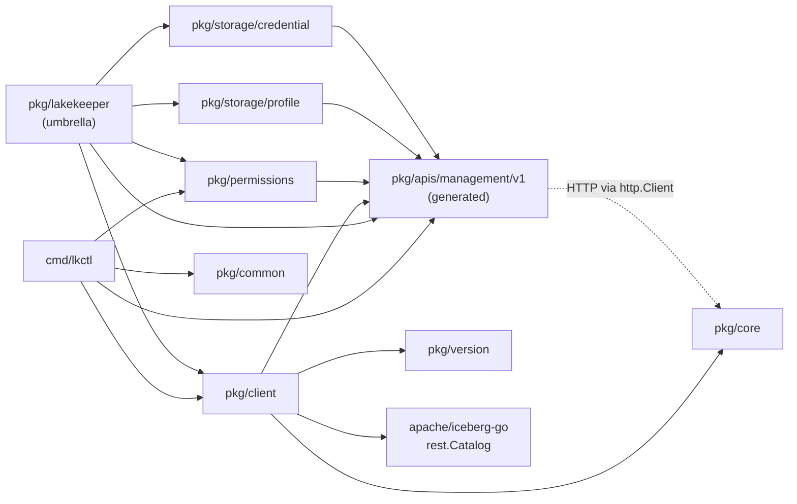
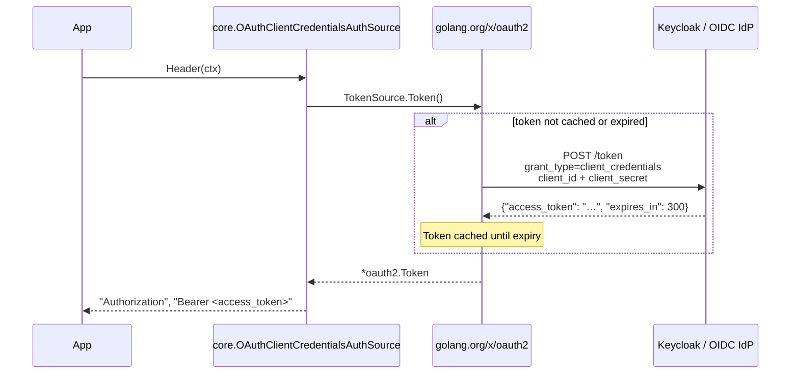

# Package Reference

Every Go package in `go-lakekeeper` — its purpose, key types, and how the
packages depend on each other. Complements [GENERATION.md](GENERATION.md)
(which covers the generated/manual split) and [ARCHITECTURE.md](ARCHITECTURE.md)
(which covers the request lifecycle).

## Dependency Graph



The generated `pkg/apis/management/v1` package is the dependency root —
nothing else in this module imports it transitively without going through
the typed packages above. `pkg/client` wires it up with auth and retries;
`pkg/permissions` and `pkg/storage/*` provide ergonomic builders on top of
its types; and `pkg/lakekeeper` re-exports a curated subset of all four for
single-import call sites.

---

## Building requests

Most request types are constructed through a generator-emitted
`New<Resource>Request` constructor that takes only the spec-required fields
positionally, plus `Set<Field>(value)` mutators for everything else:

```go
req := managementv1.NewCreateWarehouseRequest(sp, "main")  // required: profile, name
req.SetStorageCredential(sc)                               // optional
```

This is mildly more verbose than the AWS SDK's struct-literal idiom
(`&ec2.RunInstancesInput{...}`). The trade-off is that the `Set*` mutators
take plain values and hide the wrapper each optional field needs:

- Optional fields are pointers (`*string`, `*bool`, …); `req.SetX(v)` stores
  `&v`.
- Optional fields the spec marks nullable (e.g. `Description` on
  `CreateRoleRequest`) are `NullableX` wrappers with three states:
  - `req.SetDescription("x")` sends the value;
  - `req.SetDescriptionNil()` sends an explicit `null`;
  - leaving it unset (or `req.UnsetDescription()`) omits the field.

  Read them back with `.Get()`, which returns `nil` for both null and unset.

Struct literals work too, but you wrap each field yourself:
`managementv1.PtrString("x")` for a pointer field,
`*managementv1.NewNullableString(managementv1.PtrString("x"))` for a nullable
one. The setters are the recommended idiom for that reason.

For request types whose only required input is the body itself
(`SetProtectionRequest`, `RenameWarehouseRequest`, …), the umbrella's
`New<Resource>Request` is a simple value constructor with no setters
afterwards.

---

## `pkg/lakekeeper` (umbrella)

**Import path:** `github.com/lakekeeper/go-lakekeeper/pkg/lakekeeper`

Convenience umbrella that re-exports the most-used types and constructors
from `pkg/client`, `pkg/storage/{profile,credential}`, `pkg/permissions`,
and a curated subset of `pkg/apis/management/v1`. The goal is a single
import for the common call site:

```go
import "github.com/lakekeeper/go-lakekeeper/pkg/lakekeeper"

c, err := lakekeeper.New(ctx, baseURL, token)
sp := lakekeeper.NewS3Profile("bucket", "us-east-1",
    lakekeeper.WithS3Endpoint("http://minio:9000"))
sc := lakekeeper.NewS3AccessKey("ak", "sk")

req := lakekeeper.NewCreateWarehouseRequest(sp, "main")
req.SetStorageCredential(sc)

wh, err := c.Warehouses.Create(ctx, req, lakekeeper.WithProject(projectID))
```

What it re-exports:
- `Client`, `Option`, and every constructor from [`pkg/client`](#pkgclient).
- All profile and credential builders from `pkg/storage/{profile,credential}`.
- Permission helpers (`PrincipalSet`, `BuildAssignment`,
  `BuildAssignmentSet`, `DescribeAssignment`).
- Common request and response types — `Warehouse`, `Project`, `Role`,
  `User`, `CreateWarehouseRequest`, `*Assignment` family, etc. — as
  identity-preserving aliases. Values flow between the umbrella and the
  underlying `managementv1` import without conversion.

What it does **not** re-export:
- The full Management API surface. Reach for `managementv1`
  when you need a less-common type.
- Generated enum constants. Use `managementv1.<ENUM>_<VALUE>` directly
  (`managementv1.WAREHOUSESTATUS_ACTIVE`, `managementv1.S3FLAVOR_AWS`);
  an alias would only add a second name for the same value.

The umbrella is a thin file (~150 LoC) that runs `go vet` clean and
provides no behaviour of its own — every symbol resolves through
`type X = …` aliases or `var X = …` function-value references.

---

## `pkg/client`

**Import path:** `github.com/lakekeeper/go-lakekeeper/pkg/client`

The top-level facade and the public SDK interface. `Client` carries the
resource façades (`Warehouses`, `Projects`, `Roles`, `Users`, `Server`,
`Permissions`), auth wiring (via `core.AuthSource` and a custom
`http.RoundTripper`), optional retry behaviour, optional bootstrap on
construction, and a `CatalogV1` helper that delegates to
`apache/iceberg-go`. It also embeds the generated
`*managementv1.APIClient` as the escape hatch, so each generated service
handle is reachable as a public field directly on `Client`.

### Constructors

```go
// Static OAuth bearer token.
client, err := client.New(ctx, baseURL, token, options...)

// Pluggable auth via AuthSource.
client, err := client.NewWithAuthSource(ctx, baseURL, authSource, options...)
```

`AuthSource.Init` is invoked **once during construction** — no lazy
initialisation on the first request.

`baseURL` is the server root (`https://host`). A trailing `/management/v1`
(with or without a trailing slash) is trimmed, because the generated client
prepends it to every path; `BaseURL()` returns the trimmed root, and
`CatalogV1` derives `/catalog` from it.

### Resource façades (one-call ergonomic surface)

For the common case — single-body request, single-response result — reach
for the resource façades on `*Client`. Each one compresses the generator's
three-call fluent pattern (`c.WarehouseAPI.X(ctx).Body(*req).Execute()`)
into a single method call returning `(value, error)` instead of the
generator's `(value, *http.Response, error)` triple.

| Field | Purpose |
|---|---|
| `c.Warehouses` | Create and List (project-scoped); Get / Rename / Activate / Deactivate / SetProtection / Statistics / Delete (by warehouse id) |
| `c.Projects` | Create / Get / Delete / List / Rename (Get and Rename act on the `WithProject` project, else the server's default project; Delete requires `WithProject`) |
| `c.Roles` | Create / Get / Delete / List / Update / Search (project-scoped; `List` takes `client.ListRolesOptions` for paging) |
| `c.Users` | Create / Get / Delete / List (paged, server-side name filter) / Update / Whoami; not project-scoped |
| `c.Server` | Info / Bootstrap (takes `*managementv1.BootstrapRequest`); not project-scoped. `WithInitialBootstrap` uses the same two calls |
| `c.Permissions` | Access / Assignments / Grant / Revoke, per resource kind: `.Warehouses`, `.Roles`, `.Projects` (project-scoped), `.Server` |

```go
wh, err := c.Warehouses.Get(ctx, id)                // façade — one call
wh, _, err := c.WarehouseAPI.GetWarehouse(ctx, id). // generator — full control
    Execute()
```

**Coverage.** The façades cover every operation `lkctl` uses on
warehouses, projects, roles, users, and the server, plus access,
assignments, grant, and revoke for warehouse, role, project, and server
permissions. `lkctl` commands call only the façades. Not covered, and
reachable only through the [embedded generated
services](#escape-hatch-embedded-generated-services): tags, tasks, grants,
authorization checks, namespace and tabular protections, warehouse managed
access, and the less common warehouse operations (storage credential and
profile updates, delete profile, undrop, tabular search, …). For those, custom request
options, or the raw `*http.Response`, use the escape hatch.

### Façade conventions

- **Entities and request bodies** are the generated `managementv1` models.
  Read fields through their `GetX()` accessors.
- **Query parameters** are the only façade-owned types: one
  `<Operation>Options` struct per list or query operation (for example
  `client.ListWarehousesOptions`, `client.GetWarehouseStatisticsOptions`),
  passed as a pointer. `nil` or a zero field sends nothing for that
  parameter.
- **List results** are the generated list response; page with its
  `GetNextPageToken()` accessor.
- **Project scoping** is a trailing `...client.CallOption`;
  `client.WithProject(id)` sends `x-project-id`, omitting it lets the
  server apply its default project, and `WithProject("")` fails with
  `client.ErrEmptyProjectID`. The destructive project-level calls
  (`Projects.Delete`, `Permissions.Projects.Grant` / `Revoke`) require
  the option and fail with `client.ErrProjectRequired` without it. See
  [ARCHITECTURE.md](ARCHITECTURE.md#project-scoping).

```go
resp, err := c.Warehouses.List(ctx,
    &client.ListWarehousesOptions{Status: []managementv1.WarehouseStatus{managementv1.WAREHOUSESTATUS_ACTIVE}},
    client.WithProject(projectID))

stats, err := c.Warehouses.Statistics(ctx, warehouseID,
    &client.GetWarehouseStatisticsOptions{PageSize: 50, PageToken: token})
next := stats.GetNextPageToken() // "" on the last page

users, err := c.Users.List(ctx,
    &client.ListUserOptions{Name: "peter", PageSize: 50, PageToken: token})
```

### Permissions façade

`c.Permissions` holds one sub-façade per resource kind (`Warehouses`,
`Roles`, `Projects`, `Server`). Each has the same four methods, taking the
resource id and the resource's generated types:

| Method | Request | Returns |
|---|---|---|
| `Access(ctx, id, *<Op>Options)` | allowed actions; options name another principal (`PrincipalUser` / `PrincipalRole`) | generated access response |
| `Assignments(ctx, id, *<Op>Options)` | assignments; options filter by `Relations` | generated assignments response |
| `Grant(ctx, id, []<Resource>Assignment)` | the update request's `writes` | `error` |
| `Revoke(ctx, id, []<Resource>Assignment)` | the update request's `deletes` | `error` |

Grant and Revoke build the update request themselves and reject an empty
slice before any request is sent. Pass what
[`permissions.BuildAssignmentSet`](#pkgpermissions) builds. Warehouse and
role ids select their project, so these methods take no
`client.CallOption`.

`Projects` and `Server` have no `id` argument. `Projects` methods name
the project with a trailing `client.WithProject(id)`. Without it,
`Access` and `Assignments` use the server's default project, while
`Grant` and `Revoke` fail with `client.ErrProjectRequired`. The server is
a single resource and is not project-scoped.

```go
err := c.Permissions.Projects.Grant(ctx, projectSet, client.WithProject(projectID))
resp, err := c.Permissions.Server.Assignments(ctx,
    &client.GetServerAssignmentsOptions{Relations: []managementv1.ServerRelation{managementv1.SERVERRELATION_ADMIN}})
```

```go
set, err := permissions.BuildAssignmentSet[managementv1.WarehouseAssignment](
    []string{"select"}, permissions.PrincipalSet{Roles: []string{roleID}})
if err != nil {
    return err
}
if err := c.Permissions.Warehouses.Grant(ctx, warehouseID, set); err != nil {
    return err
}
access, err := c.Permissions.Warehouses.Access(ctx, warehouseID,
    &client.GetWarehouseAccessByIDOptions{PrincipalRole: roleID})
```

`Roles.Access` reads the role's authorizer actions
(`GetAuthorizerRoleActions`); `Warehouses.Access`, `Projects.Access`, and
`Server.Access` read the deprecated-upstream `/access` endpoints
(`GetWarehouseAccessById`, `GetProjectAccess`, `GetServerAccess`). They
return the action sets `lkctl` already printed, so its output is
unchanged. `Projects` uses the header variants of the project endpoints,
not the `…ById` path variants.

### Errors

When the server answers with an error status, every façade returns a
`*client.APIError`:

| Field | Meaning |
|---|---|
| `StatusCode` | HTTP status code; `0` when unknown (no response was available) |
| `Body` | Full raw response body; `Error()` includes it truncated to 1 KiB |
| `Model` | Decoded `*managementv1.ErrorModel` (code, message, type); `nil` when the body does not parse |

`APIError` unwraps to the generated `*managementv1.GenericOpenAPIError`,
so `errors.As` reaches either type. Compare `StatusCode` to tell
not-found from forbidden from conflict; there are no `IsNotFound`-style
helpers. Transport failures and context cancellation are not `APIError`s;
they come back wrapped with `%w`, so `errors.Is(err, context.Canceled)`
works.

A façade method that returns an entity never returns `(nil, nil)`: a
success status with an empty body fails with `client.ErrEmptyResponse`.

`client.WrapAPIError(op, err, resp)` is the one constructor. Callers of
the embedded generated services use it to get the same error the façades
return:

```go
out, resp, err := c.TasksAPI.ListTasks(ctx, warehouseID).Execute()
if err != nil {
    return client.WrapAPIError("list tasks", err, resp)
}
```

`resp` may be `nil`; the status is then unknown.

### Escape hatch: embedded generated services

`Client` embeds the generated `*managementv1.APIClient`, so every generated
service is exposed as a field on `*Client`, with the generator's fluent
builders and its `(value, *http.Response, error)` result:

| Field | Purpose |
|---|---|
| `c.ServerAPI` | Server info, bootstrap |
| `c.ProjectAPI` | Projects |
| `c.UserAPI` | Users |
| `c.RoleAPI` | Roles |
| `c.WarehouseAPI` | Warehouses, namespaces, tabular protections |
| `c.PermissionsOpenfgaAPI` | Assignments and access checks |
| `c.AuthorizationAPI` | Authorization metadata and action checks |
| `c.GrantAPI` | Grants |
| `c.TagAPI` | Tags |
| `c.TasksAPI` | Background task introspection |

On a project-scoped endpoint, name the project with the builder's
`XProjectId(id)` (the `x-project-id` header) and leave the deprecated
`ProjectId(id)` query builder and `project-id` body field unset; see
[ARCHITECTURE.md](ARCHITECTURE.md#project-scoping). Wrap errors with
[`client.WrapAPIError`](#errors) to get the façades' error type.

### Catalog helper

```go
catalog, err := client.CatalogV1(ctx, projectID, warehouse, opts...)
```

Returns an `*apache/iceberg-go/catalog/rest.Catalog` configured with the
client's auth token and the warehouse-scoped catalog URL.

### Options

| Option | Effect |
|---|---|
| `WithUserAgent(ua)` | Override the `User-Agent` header (default: `go-lakekeeper/<version>`) |
| `WithoutRetries()` | Disable the retry layer entirely |
| `WithRetryMax(n)` | Override the maximum retry count |
| `WithRetryWait(min, max)` | Override the backoff window |
| `WithCheckRetry(fn)` | Replace `retryablehttp`'s retry predicate |
| `WithBackoff(fn)` | Replace `retryablehttp`'s backoff algorithm |
| `WithErrorHandler(fn)` | Replace `retryablehttp`'s error handler |
| `WithInitialBootstrap(acceptTermsOfUse, isOperator, userType)` | Auto-bootstrap on first construction if the server is not yet bootstrapped. No-op when `acceptTermsOfUse` is false |

---

## `pkg/core`

**Import path:** `github.com/lakekeeper/go-lakekeeper/pkg/core`

Low-level HTTP primitives. Imports nothing else from this module; sits at
the dependency root alongside the generated client.

### Authentication

For a flow-by-flow guide that pairs each implementation below with the
equivalent `lkctl` setup, see [AUTHENTICATION.md](AUTHENTICATION.md).

`AuthSource` is the pluggable auth interface — any credential mechanism can
be swapped without changing application code.

```go
type AuthSource interface {
    Init(context.Context) error
    Header(context.Context) (key, value string, err error)
    GetToken(context.Context) (string, error)
}
```

| Method | Called | Purpose |
|---|---|---|
| `Init` | Once, eagerly during `client.NewWithAuthSource` | One-time setup — e.g. reading a file from disk |
| `Header` | Every request, by `AuthRoundTripper` | Returns the `Authorization` header key+value to inject |
| `GetToken` | On demand | Returns a raw access token; used by `Client.CatalogV1` to pass a token to `apache/iceberg-go` |

Three implementations ship in the package.

Each implementation's `Init` validates eagerly: a misconfigured token URL,
empty bearer, or unreadable service-account file surfaces as an error
from `client.NewWithAuthSource` rather than as a deferred 401 on the
first API call.

#### `OAuthClientCredentialsAuthSource` — OAuth 2.0 client credentials

The most common production choice. Wraps any
`golang.org/x/oauth2.TokenSource`, which handles token caching and silent
renewal before expiry automatically (via `oauth2.ReuseTokenSource`).

The umbrella's `lakekeeper.NewOAuthClientCredentials` is the shortest
construction path:

```go
import "github.com/lakekeeper/go-lakekeeper/pkg/lakekeeper"

c, err := lakekeeper.NewOAuthClientCredentials(ctx,
    "https://lakekeeper.example.com",
    "https://keycloak.example.com/realms/iceberg/protocol/openid-connect/token",
    "my-client", "my-secret",
    []string{"lakekeeper"})
```

The lower-level shape, when you need to pass a pre-built `oauth2.TokenSource`
(auth-code, device flow, refresh-only) or attach extra `client.Option`s:

```go
import (
    "golang.org/x/oauth2/clientcredentials"

    "github.com/lakekeeper/go-lakekeeper/pkg/client"
    "github.com/lakekeeper/go-lakekeeper/pkg/core"
)

cfg := &clientcredentials.Config{ /* … */ }
as := &core.OAuthClientCredentialsAuthSource{TokenSource: cfg.TokenSource(ctx)}
c, err := client.NewWithAuthSource(ctx, baseURL, as)
```



The struct technically accepts any `oauth2.TokenSource`, so non-client-credentials
flows (auth-code, device, refresh-only) work too. The type name is
specific to client-credentials because that is the only flow the SDK
documents and tests; if you need another flow, build the `oauth2.TokenSource`
yourself or implement `AuthSource` directly.

#### `AccessTokenAuthSource` — static bearer token

For short-lived scripts, tests, or environments where a token is obtained
out-of-band.

```go
as := &core.AccessTokenAuthSource{Token: "eyJhbGci..."}
c, err := client.NewWithAuthSource(ctx, baseURL, as)

// Or, equivalently:
c, err := client.New(ctx, baseURL, "eyJhbGci...")
```

`Init` rejects an empty token. There is no expiry handling — once the
token expires, requests return 401. Use `OAuthClientCredentialsAuthSource`
for long-running processes.

#### `K8sServiceAccountAuthSource` — Kubernetes service account

For workloads running inside a Kubernetes cluster. The projected service-account
token is mounted by the kubelet and **re-read on every request**, so the
hourly rotation is picked up without process restart.

The umbrella's `lakekeeper.NewK8sServiceAccount` is the shortest path:

```go
import "github.com/lakekeeper/go-lakekeeper/pkg/lakekeeper"

// Default token path: /var/run/secrets/kubernetes.io/serviceaccount/token
c, err := lakekeeper.NewK8sServiceAccount(ctx, baseURL, "")

// Or specify a custom path (e.g. for audience-scoped tokens)
c, err = lakekeeper.NewK8sServiceAccount(ctx, baseURL, "/var/run/secrets/lakekeeper/token")
```

The lower-level shape:

```go
as := &core.K8sServiceAccountAuthSource{}                            // default path
as := &core.K8sServiceAccountAuthSource{ServiceAccountTokenPath: &p} // custom

c, err := client.NewWithAuthSource(ctx, baseURL, as)
```

`Init` validates the token file is readable at construction. Subsequent
`Header` calls re-read on each request — file reads against tmpfs are
sub-microsecond, and the kubelet writes via atomic rename, so partial
reads are impossible. Lakekeeper must be configured to trust your
cluster's OIDC issuer; the auth source sends the raw k8s JWT directly
without exchanging it through an IdP.

#### Choosing an `AuthSource`

| Scenario | Recommended |
|---|---|
| Production service with an OIDC IdP (Keycloak, Dex, …) | `OAuthClientCredentialsAuthSource` (or `lakekeeper.NewOAuthClientCredentials`) |
| Short-lived script or manual testing | `AccessTokenAuthSource` (or `lakekeeper.New`) |
| Workload running inside Kubernetes | `K8sServiceAccountAuthSource` (or `lakekeeper.NewK8sServiceAccount`) |
| Custom token logic (refresh token, device flow, …) | Build an `oauth2.TokenSource` or implement `AuthSource` directly |

### Other types in `pkg/core`

| Type / function | Description |
|---|---|
| `AuthRoundTripper` | `http.RoundTripper` that injects the `AuthSource`'s header on every outbound request. Used by `pkg/client` to wire auth into the generated client's underlying `*http.Client` |
| `RequestOptionFunc`, `WithHeader`, `WithHeaders`, `WithContext`, `WithQueryParams` | Per-request modifiers |
| `Ptr[T any](v T) *T` | Convenience helper for taking the address of a literal — useful when calling generated setters that expect `*T` |

---

## `pkg/apis/management/v1`

**Import path:** `github.com/lakekeeper/go-lakekeeper/pkg/apis/management/v1`
**Linter alias:** `managementv1` (enforced by `importas` in `.golangci.yml`)

**This package is generated from the OpenAPI spec.** See
[GENERATION.md](GENERATION.md) for the full picture.

It contains the generated `*APIClient`, per-resource `*APIService` types
(`ProjectAPIService`, `WarehouseAPIService`, `RoleAPIService`,
`UserAPIService`, `ServerAPIService`, `PermissionsOpenfgaAPIService`,
`AuthorizationAPIService`, `GrantAPIService`, `TagAPIService`,
`TasksAPIService`), and a few hundred model types (one file per model,
prefix `model_`).

The generated client is normally accessed through
[`pkg/client`](#pkgclient) rather than instantiated directly. Use the
resource façades on `*client.Client` for routine operations and the
embedded service fields only for operations without a façade. The
`managementv1` model types stay the entities and request bodies the
façades take and return (e.g. `managementv1.NewBootstrapRequest(true)`).

---

## `pkg/permissions`

**Import path:** `github.com/lakekeeper/go-lakekeeper/pkg/permissions`

For the authorization model, common assignment values, and end-to-end
grant/revoke workflows, see [AUTHORIZATION.md](AUTHORIZATION.md).

Generic helpers on top of the generated `*Assignment` union types. Every
resource-specific assignment in the generated client (`ServerAssignment`,
`ProjectAssignment`, `WarehouseAssignment`, `RoleAssignment`, …)
serializes to the same wire shape: `{"type": <relation>, "user"|"role": <id>}`.
This package consumes and produces that shape generically, so callers don't
hard-code which discriminator branch each relation belongs to.

| Symbol | Description |
|---|---|
| `PrincipalKind` (constants `PrincipalUser`, `PrincipalRole`) | Wire-format principal discriminator |
| `PrincipalSet` | `{Users []string; Roles []string}` for multi-relation grant/revoke |
| `AssignmentRow` | Flattened `{PrincipalType, PrincipalID, Relation}` projection used by display layers |
| `BuildAssignment[T any](relation string, kind PrincipalKind, id string) (T, error)` | Builds a typed `*Assignment` for any resource by JSON-roundtripping the wire shape into the union's generated `UnmarshalJSON` |
| `BuildAssignmentSet[T any](relations []string, set PrincipalSet) ([]T, error)` | Expands `relations × (set.Users + set.Roles)` into a slice of `*Assignment` values for assignment to a request's `Writes` (grant) or `Deletes` (revoke) field. Replaces the four-line nested loop that previously appeared at every grant/revoke call site |
| `DescribeAssignment(a any) (AssignmentRow, bool)` | Inverse of `BuildAssignment` — extracts the wire shape from any `*Assignment` value |

The `lkctl` `grant` / `revoke` / `assignments` subcommands use these
helpers; see [`cmd/lkctl/commands/`](../cmd/lkctl/commands/) for examples.

### Relation strings

`BuildAssignment` / `BuildAssignmentSet` take the relation as a `string`
to keep them resource-generic, but the spec exports a typed enum per
resource: `managementv1.WarehouseRelation`, `ProjectRelation`,
`RoleRelation`, `ServerRelation`, `NamespaceRelation`, `TableRelation`,
`ViewRelation`. Their constants
(`managementv1.WAREHOUSERELATION_OWNERSHIP`,
`managementv1.PROJECTRELATION_DESCRIBE`, …) are typed strings that pass
straight in via conversion:

```go
writes, err := permissions.BuildAssignmentSet[managementv1.WarehouseAssignment](
    []string{string(managementv1.WAREHOUSERELATION_OWNERSHIP)},
    permissions.PrincipalSet{Users: []string{userID}},
)
```

Using the constants instead of bare `"ownership"` literals catches typos
at compile time when the spec eventually changes a relation name. The
SDK still accepts arbitrary strings so a relation introduced server-side
before a client regen can be passed without a code change.

---

## `pkg/storage/profile`

**Import path:** `github.com/lakekeeper/go-lakekeeper/pkg/storage/profile`

Ergonomic builders for the `StorageProfile{S3,Gcs,Adls}` variants emitted
by the generator. Each provider has a `New<Provider>Profile` constructor
that takes the spec-mandated fields positionally and accepts a variadic
list of `With*` options for the optional ones.

```go
import "github.com/lakekeeper/go-lakekeeper/pkg/storage/profile"

sp := profile.NewS3Profile("my-bucket", "us-east-1",
    profile.WithS3Endpoint("http://minio:9000"),
    profile.WithS3PathStyleAccess(),
)
req.StorageProfile = sp
```

Constructors return the `managementv1.StorageProfile` umbrella union
directly — callers pass the value straight to request setters without an
intermediate `…AsStorageProfile` wrap step.

For the read direction, use the `As*` accessors — symmetric with the
builders:

```go
wh, err := c.Warehouses.Get(ctx, id)

if s3, ok := profile.AsS3(wh.GetStorageProfile()); ok {
    fmt.Println(s3.GetBucket(), s3.GetRegion())
}
```

The accessors return `(*<variant>, false)` when the union holds a
different variant, replacing the
`if wh.StorageProfile.StorageProfileS3 != nil { … }` ladder.

`profile.AsS3` / `AsGCS` / `AsADLS` and `credential.AsS3AccessKey` /
`AsS3AwsSystemIdentity` / etc. are also re-exported from the umbrella as
`lakekeeper.AsS3Profile` etc.

---

## `pkg/storage/credential`

**Import path:** `github.com/lakekeeper/go-lakekeeper/pkg/storage/credential`

Ergonomic builders for the `StorageCredential` variants. Unlike `profile`,
these constructors return the umbrella `managementv1.StorageCredential`
union directly, because the credential variants don't usually need
additional options.

```go
import "github.com/lakekeeper/go-lakekeeper/pkg/storage/credential"

cred := credential.NewS3AccessKey("access-key-id", "secret-access-key")
req.SetStorageCredential(cred)
```

Available constructors include `NewS3AccessKey`,
`NewS3AccessKeyWithExternalID`, `NewS3AwsSystemIdentity`,
`NewS3CloudflareR2`, `NewGCSServiceAccountKey`, `NewGCSSystemIdentity`,
`NewAZClientCredentials`, `NewAZSharedAccessKey`, and
`NewAZManagedIdentity`. See
[`pkg/storage/credential/`](../pkg/storage/credential/) for the full list.

---

## `pkg/apis/management/v1tests`

**Import path:** `github.com/lakekeeper/go-lakekeeper/pkg/apis/management/v1tests`

Wire-format round-trip tests for the generated assignment models. Lives
**outside** `pkg/apis/management/v1/` so test fixtures don't bleed into the
generated package (which is rebuilt wholesale by `make generate`).

When the spec or the generator config changes shape, the tests in here are the
fastest signal that something has broken.

---

## `pkg/common`

**Import path:** `github.com/lakekeeper/go-lakekeeper/pkg/common`

Environment-variable names and defaults shared between the CLI and any
embedding code.

| Symbol | Value |
|---|---|
| `EnvBaseURL` | `LAKEKEEPER_BASE_URL` |
| `EnvTokenURL` | `LAKEKEEPER_TOKEN_URL` |
| `EnvClientID` | `LAKEKEEPER_CLIENT_ID` |
| `EnvClientSecret` | `LAKEKEEPER_CLIENT_SECRET` |
| `EnvScope` | `LAKEKEEPER_SCOPE` |
| `EnvBootstrap` | `LAKEKEEPER_BOOTSTRAP` |
| `DefaultBaseURL` | `http://localhost:8181` |
| `DefaultScope` | `["lakekeeper"]` |

---

## `pkg/version`

**Import path:** `github.com/lakekeeper/go-lakekeeper/pkg/version`

Build-time version info injected via `ldflags` by goreleaser and
`make build`. Returns a struct with `Version`, `Commit`, `Date`, and
`TreeState`. The `User-Agent` header sent by `client.Client` is
`go-lakekeeper/<version>`.

---

## `pkg/testutil`

**Import path:** `github.com/lakekeeper/go-lakekeeper/pkg/testutil`

The `httptest` harness for façade and `lkctl` command tests. Not intended
for use outside tests.

| Helper | Purpose |
|---|---|
| `NewServer(t)` | Starts a test server; returns its `*http.ServeMux` and base URL |
| `ServerMux(t)` | `NewServer` plus a `*client.Client` pointed at it (static token, no retries) |
| `Respond(t, mux, pattern, status, body)` | Registers a canned response and returns a `*RequestLog` |
| `RequestLog.Last(t)` / `Len()` | The recorded requests as `CapturedRequest` (method, path, query, header, body) |

Façade tests live in `package client_test` (an internal test importing
`testutil` would be an import cycle).

---

## `cmd/lkctl`

The CLI binary entry point. Delegates immediately to
`cmd/lkctl/commands.NewCommand()`, which builds the Cobra command tree.
Commands call the `pkg/client` façades only, never a generated
`*APIService`; they use `managementv1` for model types. A `forbidigo` rule
in `.golangci.yml` enforces this for `cmd/` (`make lint`).
See [CLI.md](CLI.md) for the full command reference.
